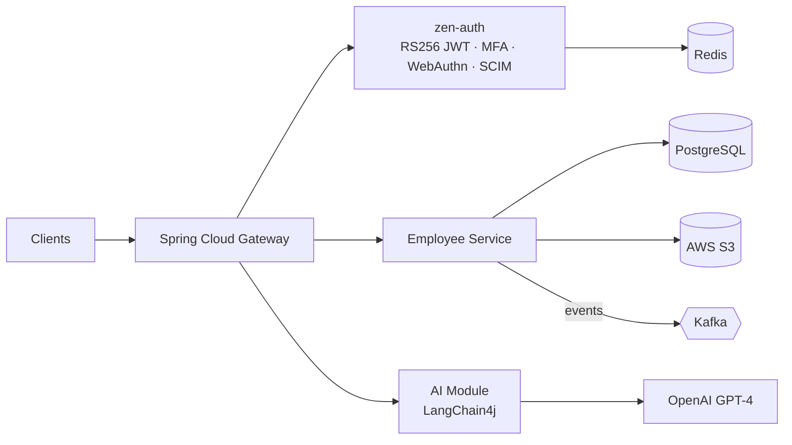

<h1 align="center">Pritesh Ingale</h1>

  

  
  
  

---

## 👋 About me

Java backend engineer with **5+ years** building REST APIs, event-driven microservices and distributed systems on **Spring Boot, Kafka, Redis and AWS**.

- 🛫 **Today:** SDE-II at **Accelya**, working on **ONO**, an offer-and-order airline commerce platform for Finnair: order lifecycle, ticketing, ancillaries, 24×7 production, strict SLAs.
- 🏗️ **On the side:** founder and sole architect of **ZenWorks HRMS**, a multi-tenant SaaS platform with an LLM-powered resume-matching pipeline.
- ⚡ **What I'm good at:** finding why an API is slow and fixing it (N+1 queries, caching, indexing, pagination), and owning services end to end, from schema design to deployment.
- 🤖 **How I work:** I use AI-assisted tools (Cursor, Copilot, Windsurf) to move faster, and I keep full ownership of architecture and code quality.

---

## 🛠️ Tech stack

**Languages & frameworks**

**Data, messaging & caching**

**Cloud & DevOps**

**Observability**

<b>Full skill list</b>

| Area | Details |
|---|---|
| Backend | Spring Boot 2.x/3.x, Spring MVC, Spring Security, Spring Cloud Gateway, Hibernate/JPA, QueryDSL, MapStruct, Resilience4j |
| Architecture | Microservices, event-driven architecture, API gateway, DDD, multi-tenancy, system design |
| Security | OAuth 2.0, JWT (RS256), RBAC, TOTP MFA, WebAuthn, SCIM 2.0 |
| Migrations | Liquibase, Flyway |
| Quality & perf | JMeter, SonarQube, Swagger/OpenAPI 3.0, TDD, code review |
| AI engineering | LangChain4j, OpenAI GPT-4 APIs, prompt engineering |

---

## 🚀 Featured project: ZenWorks HRMS

A multi-tenant SaaS HRMS backend that I'm designing and building solo from scratch.

| Service | What it does |
|---|---|
| **zen-auth** | RS256 JWT with refresh-token rotation, Redis-based token blacklisting, TOTP MFA, OAuth 2.0, WebAuthn, SCIM 2.0 provisioning |
| **Employee Service** | PostgreSQL + Flyway migrations, Kafka event publishing, S3 document storage, MapStruct mapping, JPA Specifications for dynamic filtering |
| **AI Module** | Prompt-orchestrated pipeline for resume parsing and candidate–job matching (LangChain4j + GPT-4); exploring pgvector for embedding-based search |

**Stack:** Java 17 · Spring Boot 3.x · PostgreSQL · Redis · Kafka · Spring Cloud Gateway · Resilience4j · Flyway · AWS · Docker · LangChain4j

> 🔗 [Repo / write-up: add link]

---

## 💼 Experience

| Period | Role | What I did |
|---|---|---|
| Apr 2026 – now | **SDE-II, Accelya** | ONO (offer & order) platform for Finnair; production defect triage in a 24×7 regulated environment; root-cause analysis across a multi-service architecture; legacy modernization |
| Apr 2024 – Apr 2026 | **Software Engineer, Daten & Wissen** (client: Keva Flavours) | Sole backend engineer on a global fragrance-industry SaaS; 40+ REST APIs; performance work; EU regulatory instance with ECHA / IUCLID 6 integration; zero-downtime Jenkins pipelines |
| Nov 2021 – Apr 2024 | **Software Engineer, Job Circle** | Sole backend owner of four microservices (Job Apply, Referral, ATS, Leave Management) on a live recruitment platform; Kafka, Redis, AWS |
| Sep – Nov 2021 | **Freelance Full-Stack Java Developer** | FoodBox ordering platform: Spring Boot + Angular, Razorpay webhooks, Docker + Jenkins |

---

## 🔧 Selected engineering work

<b>⚡ Fixing N+1 bottlenecks on a global SaaS platform</b>

- **Problem:** high-traffic endpoints on a globally deployed platform were slow because of N+1 queries.
- **Approach:** Redis caching, MySQL composite indexing, cursor-based pagination.
- **Result:** substantially lower API latency across the affected endpoints.
<!-- Add your real before/after numbers here, e.g. p95 from X ms to Y ms. -->

<b>🇪🇺 Isolated EU instance with regulatory API integration</b>

- Dedicated European deployment with ECHA / IUCLID 6 integration.
- Isolated schema of 20+ tables, with data separation enforced via Spring Cloud Gateway routing.
- 40+ REST APIs secured with Spring Security RBAC; DEV/UAT/PROD Spring Profiles; Liquibase schema versioning.

<b>🧩 Breaking a JSP monolith into microservices (VCMP)</b>

- Decomposed a JSP monolith into two Spring Boot 3.x services.
- Replaced synchronous calls with Kafka event streams.
- Secured access with OAuth 2.0 / JWT through Spring Cloud Gateway.

<b>👥 Recruitment platform microservices (Job Circle)</b>

- Four independent services owned end to end, from schema design to deployment on AWS (EC2, RDS, S3).
- Keyword-based job matching, referral workflow, Kafka-driven async notifications, Redis session caching.
- Docker + Jenkins CI/CD; Flutter mobile client for the platform.

---

## 📊 GitHub stats

  
  

---

## 📫 Let's connect

- 💼 [LinkedIn](https://www.linkedin.com/in/pritesh-ingale-1902b6105/)
- ✉️ [pritesh1272@gmail.com](mailto:pritesh1272@gmail.com)
- 📍 Thane, Mumbai, India · English, Hindi, Marathi

Built with Java, caffeine and a lot of Kafka topics.

